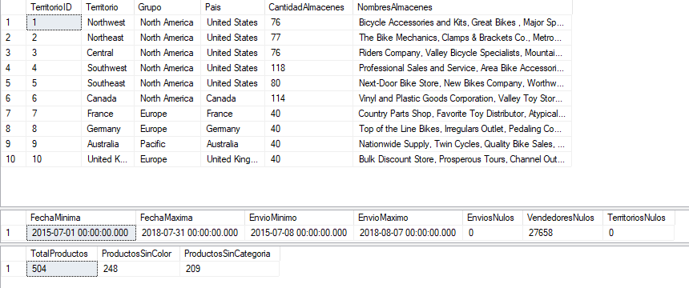
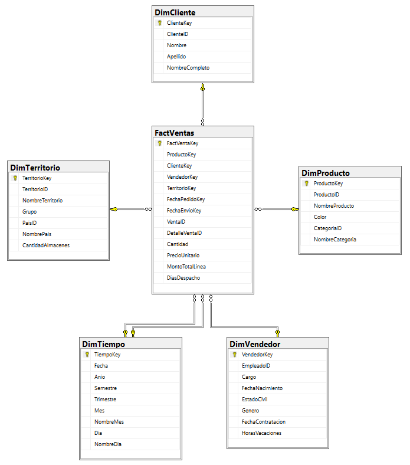
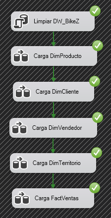
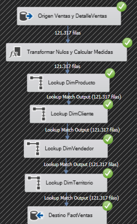
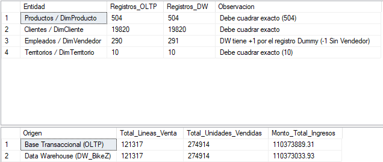
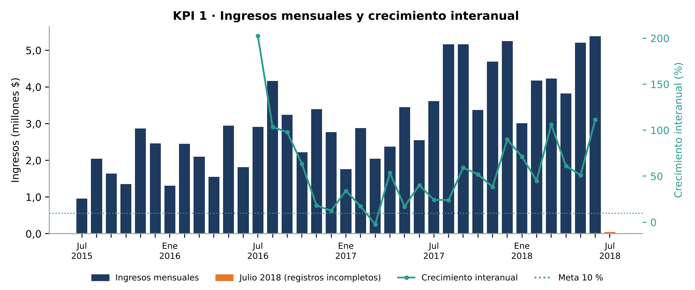

# Certamen 2 - Inteligencia de Negocios

## Caso seleccionado
**Caso 2: Bike Z** - Empresa comercializadora de artículos para motocross.

## Integrantes y sección
* **Integrante 1:** Vicente Zubicueta - '@vicenzubi'
* **Integrante 2:** Joaquín Ojeda - '@OjedaDev'
* **Paralelo:** 301

## Descripción del problema
Bike Z es una empresa de venta de artículos para motocross que ha experimentado un rápido crecimiento. Actualmente carece de herramientas analíticas e indicadores estructurados que permitan a la gerencia evaluar el desempeño comercial, el comportamiento de las ventas por territorio, el rendimiento de los vendedores y la eficiencia en los despachos para apoyar la toma de decisiones.

## Objetivo del proyecto
Diseñar e implementar una solución integral de Inteligencia de Negocios (Data Warehouse, proceso ETL, Cubo OLAP y Dashboard en Power BI) que transforme los datos transaccionales de Bike Z en información estratégica mediante indicadores clave de rendimiento (KPIs).

## KPI definidos
Para apoyar la toma de decisiones de la gerencia de Bike Z, se definieron 4 indicadores clave de desempeño (KPI):

1. **Crecimiento de Ingresos por Ventas (%):**
   * **Métrica:** Variación porcentual de ingresos totales (`Cantidad * PrecioUnitario`) entre períodos (mensual, trimestral, anual).
   * **Justificación:** Permite monitorear el ritmo de crecimiento de la compañía e identificar mercados (`País` y `Territorio`) en expansión o contracción.
2. **Tiempo Promedio de Despacho (Lead Time en días):**
   * **Métrica:** Promedio de días transcurridos entre la fecha de venta (`Fecha`) y la fecha de despacho (`FechaEnvio`).
   * **Justificación:** Permite evaluar la eficiencia logística en un contexto de rápido crecimiento comercial, detectando demoras críticas por territorio y zona geográfica.
3. **Rentabilidad y Volumen por Categoría de Producto:**
   * **Métrica:** Suma de ingresos (`MontoTotalLinea`) y unidades vendidas (`Cantidad`) desglosadas por `Categoría`, `Producto` y `Color`.
   * **Justificación:** Facilita la identificación de productos estrella para optimizar el abastecimiento de inventario y focalizar estrategias de venta.
4. **Rendimiento Comercial y Ticket Promedio por Vendedor:**
   * **Métrica:** Ingresos totales generados divididos por el número de órdenes gestionadas por cada empleado (`VendedorID`).
   * **Justificación:** Permite evaluar el desempeño de la fuerza de ventas y analizar su relación con variables como cargo, antigüedad (`FechaContratacion`) y disponibilidad (`HorasVacaciones`).

## Análisis de calidad y utilidad de los datos (OLTP)
Previo al diseño del Data Warehouse, se ejecutó un diagnóstico exploratorio sobre la base de datos relacional (`database/scripts/00_Analisis_Calidad_OLTP.sql`) para evaluar la integridad referencial, completitud y utilidad de los datos de origen. Se identificaron 4 hallazgos críticos que determinaron las reglas de negocio del modelo dimensional y del proceso ETL:

| Tabla / Entidad Analizada | Hallazgo en Base Transaccional (OLTP) | Impacto Analítico | Decisión de Diseño y Regla de Limpieza (ETL) |
| :--- | :--- | :--- | :--- |
| **`Ventas` (`VendedorID`)** | Existen **27.658 ventas** con `VendedorID` en `NULL` (ventas directas/online sin vendedor asignado). | Un cruce estándar (`INNER JOIN`) descartaría estas transacciones, provocando una pérdida masiva de ingresos reales en el análisis. | Se insertó un **Registro Dummy** en `DimVendedor` (`EmpleadoID = -1`, `'Sin Vendedor (Venta Directa)'`) y en el ETL se transforman los `NULL` a `-1`. |
| **`Productos` (`Color` y `CategoriaID`)** | De un total de **504 productos**, **248** tienen `Color` en `NULL` y **209** tienen `CategoriaID` en `NULL`. | Unir `Productos` y `Categorias` mediante `INNER JOIN` excluiría el 41,5% del catálogo de productos. | Uso de `LEFT JOIN` hacia `Categorias`. En el ETL se reemplazan los valores nulos por `'Sin Color'`, `CategoriaID = -1` y `'Sin Categoría'`. |
| **`Territorios` y `Almacenes`** | Relación `1:N` entre los **10 territorios** y `Almacenes` (entre **40 y 118 almacenes** por territorio), sin clave directa de almacén en `Ventas`. | Incluir el detalle individual de almacenes en la dimensión generaría duplicidad de filas (producto cartesiano) al cruzar por `TerritorioID`. | Desnormalización en `DimTerritorio` integrando `Paises` y agregando la métrica consolidada `CantidadAlmacenes` por territorio. |
| **`Ventas` (`Fecha` y `FechaEnvio`)** | Pedidos entre **`2015-07-01`** y **`2018-07-31`**, y despachos entre **`2015-07-08`** y **`2018-08-07`**. `0` nulos en fechas y `0` nulos en `TerritorioID`. | Alta calidad e integridad temporal para el cálculo del *Lead Time* de despacho (`DiasDespacho`). | Generación continua de `DimTiempo` cubriendo años calendarios completos desde `2015-01-01` hasta `2018-12-31`. |

### Evidencia del diagnóstico en SQL Server



## Modelo dimensional
Se diseñó un **Modelo Estrella (Star Schema)** aplicando la metodología de los 4 pasos de Ralph Kimball:

### 1. Proceso de negocio
**Gestión de ventas y despacho de artículos de motocross.** Es el proceso crítico del negocio que registra las transacciones comerciales con clientes, el desempeño de los vendedores y los tiempos de envío asociados a cada territorio.

### 2. Granularidad
El nivel de granularidad corresponde a **cada línea de detalle de una orden de venta (`DetalleVentas`)**, registrando la venta de un producto específico, en una cantidad y precio determinados, a un cliente, por un vendedor, en un territorio y fechas (pedido y envío) específicos.

### 3. Dimensiones
Se definieron 5 dimensiones desnormalizadas para conformar un esquema en estrella óptimo para consultas analíticas:
* **`DimTiempo`:** Dimensión de rol múltiple (*Role-Playing Dimension*) para representar tanto la fecha de venta como la fecha de envío (`TiempoKey`, `Fecha`, `Anio`, `Trimestre`, `Mes`, `NombreMes`, `Dia`).
* **`DimProducto`:** Integra las tablas transaccionales `Productos` y `Categorias` (`ProductoKey`, `ProductoID`, `NombreProducto`, `Color`, `CategoriaID`, `NombreCategoria`).
* **`DimTerritorio`:** Integra las tablas `Territorios`, `Paises` y la referencia de `Almacenes` (`TerritorioKey`, `TerritorioID`, `NombreTerritorio`, `Grupo`, `PaisID`, `NombrePais`, `Almacen`).
* **`DimCliente`:** Contiene la información del comprador (`ClienteKey`, `ClienteID`, `Nombre`, `Apellido`, `NombreCompleto`).
* **`DimVendedor`:** Basada en la tabla `Empleados` (`VendedorKey`, `EmpleadoID`, `Cargo`, `Genero`, `EstadoCivil`, `FechaNacimiento`, `FechaContratacion`, `HorasVacaciones`).

### 4. Tabla de hechos y medidas
* **Tabla de Hechos:** `FactVentas`
* **Claves Foráneas:** `ProductoKey`, `ClienteKey`, `VendedorKey`, `TerritorioKey`, `FechaPedidoKey`, `FechaEnvioKey`.
* **Claves Degeneradas:** `VentaID`, `DetalleVentaID`.
* **Medidas:**
  * `Cantidad` (Aditiva): Unidades vendidas en la línea de detalle.
  * `PrecioUnitario` (Semi-aditiva): Precio unitario del producto.
  * `MontoTotalLinea` (Aditiva - Derivada): Ingreso bruto de la línea (`Cantidad * PrecioUnitario`).
  * `DiasDespacho` (Semi-aditiva - Derivada): Días entre pedido y envío (`FechaEnvio - Fecha`).

### Implementación física y Diagrama del Modelo Estrella
El script DDL de creación de la base de datos dimensional (`DW_BikeZ`), junto con el poblamiento inicial de `DimTiempo` y el registro *Dummy* de vendedores, se encuentra disponible en [`database/scripts/01_Crear_DW_BikeZ.sql`](database/scripts/01_Crear_DW_BikeZ.sql).



## Proceso ETL - Fase 1
### Arquitectura Idempotente
1. **Limpieza Previa:** Se utiliza un *Execute SQL Task* que elimina los registros en orden jerárquico, reinicia los contadores `IDENTITY` y reinserta los *Dummys* antes de cada carga, garantizando que el paquete sea re-ejecutable sin duplicar datos.
2. **Transformaciones:** Uso de componentes *Derived Column* y *Lookups* para asignación de *Surrogate Keys*. 




### Validación y Cuadratura
Se verificó la carga exacta de las **121.317 líneas de venta**, **274.914 unidades** y **$110.373.889,31 en ingresos** entre la base transaccional y el Data Warehouse. El script de auditoría está en [`02_Validacion_Carga_ETL.sql`](database/scripts/02_Validacion_Carga_Etl.sql).


---
## Capa analítica - Fase 2
Para no modificar el modelo físico ni el ETL validados en la Fase 1, se creó una capa de **vistas analíticas** sobre `DW_BikeZ` ([`03_Vistas_Analiticas.sql`](database/scripts/03_Vistas_Analiticas.sql)) que alimenta tanto al cubo OLAP como al dashboard:

| Vista | Atributos agregados | Uso |
| :--- | :--- | :--- |
| `vw_DimTiempo` | Claves y nombres únicos por nivel (`SemestreKey`, `TrimestreKey`, `MesKey`, `MesNombre`...) | Jerarquía *Calendario* Año > Semestre > Trimestre > Mes > Fecha |
| `vw_DimProducto` | `GrupoCategoria` (Bicicletas, Componentes, Vestuario, Accesorios, Sin Categoría) | Jerarquía *Categorías* |
| `vw_DimVendedor` | `NombreVendedor`, `TipoVenta`, `AniosAntiguedad`, `Edad` y rangos de antigüedad, vacaciones y edad | Análisis del KPI 4 |
| `vw_DimTerritorio`, `vw_DimCliente` | Paso directo | Consistencia de la capa |
| `vw_FactVentas` | `EsPrimeraLineaOrden`, `DiasDespachoOrden`, `EsDespachoTardio` | KPI 2 calculado **por orden** y no por línea |

Los valores de referencia de cada KPI se calculan en SQL con [`04_Consultas_KPI.sql`](database/scripts/04_Consultas_KPI.sql) y se usan para validar el cubo y el dashboard.

## Cubo OLAP - Fase 2
Proyecto **SSAS Multidimensional** `OLAP_BikeZ` (carpeta [`olap/proyecto-ssas/`](olap/proyecto-ssas/)), con el cubo **`Cubo Ventas BikeZ`**:

* **Dimensiones:** `Fecha Pedido` y `Fecha Envio` (rol múltiple de *Tiempo*), `Producto`, `Cliente`, `Vendedor` y `Territorio`, con las jerarquías *Calendario*, *Categorias*, *Fuerza de Ventas* y *Geografia*.
* **Grupos de medidas:** `Ventas` (Monto Ventas, Unidades Vendidas, Lineas Venta, Ordenes Despacho Tardio, Dias Despacho Maximo y medidas auxiliares) y `Ordenes` (conteo distinto de `VentaID`).
* **Cálculos MDX** ([`Calculos_Cubo_BikeZ.mdx`](olap/proyecto-ssas/Calculos_Cubo_BikeZ.mdx)): crecimiento vs período anterior e interanual (`ParallelPeriod`), tiempo promedio de despacho por orden, participación por categoría y vendedor, ticket promedio.
* **KPI del cubo** ([`KPI_Cubo_BikeZ.md`](olap/proyecto-ssas/KPI_Cubo_BikeZ.md)): valor, meta, estado y tendencia para los 4 KPI.
* **Validación:** [`Consultas_Validacion_Cubo.mdx`](olap/proyecto-ssas/Consultas_Validacion_Cubo.mdx) con los valores esperados de cada consulta.

## Dashboard Power BI - Fase 2
Archivo [`powerbi/Dashboard_BikeZ.pbix`](powerbi/) en modo **Importar** desde las vistas de `DW_BikeZ` (el archivo es autocontenido y puede abrirse sin conexión al servidor). Contiene 5 páginas orientadas a la gerencia:

1. **Resumen Ejecutivo** - tarjetas de los 4 KPI, tendencia mensual y mapa por país.
2. **KPI 1 · Crecimiento de ingresos** - crecimiento interanual y mensual, matriz país × año.
3. **KPI 2 · Tiempo de despacho** - medidor contra la meta de 7 días, detalle por territorio y mes.
4. **KPI 3 · Catálogo** - participación por grupo y categoría, top 10 de productos.
5. **KPI 4 · Fuerza de ventas** - ingresos y ticket por vendedor, antigüedad y venta directa.

Las medidas DAX están en [`Medidas_DAX_BikeZ.dax`](powerbi/Medidas_DAX_BikeZ.dax) y el tema corporativo en [`Tema_BikeZ.json`](powerbi/Tema_BikeZ.json).

### Principales resultados
| KPI | Resultado |
| :--- | :--- |
| Crecimiento de ingresos | +37,1 % en 2017 vs 2016; +71,6 % en ene-jun 2018 vs ene-jun 2017. Europa y Pacífico crecen más rápido que Norteamérica. |
| Tiempo de despacho | 6,99 días promedio por orden; 98,5 % de las órdenes se despacha en exactamente 7 días. |
| Categorías | Las bicicletas generan el 86,2 % de los ingresos con el 32,8 % de las unidades. |
| Vendedores | 26,6 % de los ingresos proviene de ventas directas; ticket de la fuerza de ventas 21.281 vs 1.061 en venta directa. |



## Tecnologías utilizadas
* **Motor de Base de Datos:** Microsoft SQL Server (SSMS)
* **Proceso ETL:** SQL Server Integration Services (SSIS) en Visual Studio 
* **Cubo OLAP:** SQL Server Analysis Services (SSAS) Multidimensional en Visual Studio
* **Dashboard:** Power BI Desktop
* **Control de Versiones:** Git & GitHub

## Estructura del repositorio
```text
CERTAMEN2-BI/
|-- README.md
|-- docs/
| |-- modelo-dimensional/
| `-- fase2/            (gráficos de resultados y wireframes del dashboard)
|-- database/
| |-- scripts/
| `-- backup/
|-- etl/
| `-- proyecto-ssis/
|-- olap/
| `-- proyecto-ssas/     (proyecto OLAP_BikeZ, cálculos MDX, KPI y consultas de validación)
`-- powerbi/
  |-- Dashboard_BikeZ.pbix
  |-- Medidas_DAX_BikeZ.dax
  `-- Tema_BikeZ.json
```

## Instrucciones de ejecución/revisión
Para que el profesor pueda replicar y evaluar el proyecto sin errores de conexión o dependencias, se deben seguir estos pasos:

### Prerrequisitos
* **Motor de BD:** Microsoft SQL Server y SQL Server Management Studio (SSMS).
* **ETL:** Visual Studio con la extensión de *Integration Services* (SSIS) instalada.
* Tener restaurada la base de datos transaccional original (`BikeZ`) en el servidor local.

### Paso 1: Despliegue del Data Warehouse
Existen dos opciones para cargar la base de datos dimensional en su entorno local:
* **Opción A (Desde cero):** Abrir SSMS y ejecutar el script [`database/scripts/01_Crear_DW_BikeZ.sql`](database/scripts/01_Crear_DW_BikeZ.sql). Esto creará la base `DW_BikeZ` vacía, construirá el modelo en estrella y poblará la dimensión `DimTiempo`.
* **Opción B (Restaurar Backup):** En SSMS, restaurar el archivo `DW_BikeZ.bak` ubicado en la carpeta [`database/backup/`](database/backup/).

### Paso 2: Ejecución del proceso ETL
1. Abrir la solución de Visual Studio ubicada en [`etl/proyecto-ssis/ETL_BikeZ.sln`](etl/proyecto-ssis/ETL_BikeZ/ETL_BikeZ.sln).
2. En el panel *Connection Managers*, verificar que las conexiones `CM_OLTP_BikeZ` y `CM_DW_BikeZ` apunten al nombre de su servidor local (ej. `localhost` o `.\SQLEXPRESS`).
3. Abrir el paquete `Carga_DW_BikeZ.dtsx` y presionar **Iniciar (Start)**.
4. El paquete ejecutará primero la tarea de limpieza (`Limpiar DW_BikeZ`) garantizando la idempotencia, y luego poblará las 5 dimensiones y la tabla de hechos.

### Paso 3: Verificación 
Para verificar que los datos cargados son exactos, ejecutar el script [`database/scripts/02_Validacion_Carga_ETL.sql`](database/scripts/02_Validacion_Carga_Etl.sql) en SSMS.

### Paso 4: Capa analítica (Fase 2)
1. Ejecutar [`03_Vistas_Analiticas.sql`](database/scripts/03_Vistas_Analiticas.sql) en SSMS (si se restauró el backup, las vistas ya existen).
2. (Opcional) Ejecutar [`04_Consultas_KPI.sql`](database/scripts/04_Consultas_KPI.sql) para obtener los valores de referencia de los KPI.

### Paso 5: Cubo OLAP
1. Abrir la solución `etl/proyecto-ssis/ETL_BikeZ/ETL_BikeZ.sln` (incluye el proyecto `OLAP_BikeZ`) o directamente el proyecto de `olap/proyecto-ssas/`.
2. En el *Data Source* `DW BikeZ`, ajustar el nombre del servidor. En las propiedades del proyecto (*Deployment*), ajustar el servidor de Analysis Services.
3. **Deploy** del proyecto. Si aparece *Login failed for user 'NT Service\MSSQLServerOLAPService'*, ejecutar [`05_Permisos_SSAS.sql`](database/scripts/05_Permisos_SSAS.sql) y volver a procesar.
4. Validar con [`Consultas_Validacion_Cubo.mdx`](olap/proyecto-ssas/Consultas_Validacion_Cubo.mdx) en SSMS (conexión a Analysis Services).

### Paso 6: Dashboard
Abrir `powerbi/Dashboard_BikeZ.pbix` con Power BI Desktop. Para refrescar los datos, ajustar el servidor en *Transformar datos > Configuración de origen de datos*.

---
## Distribución de responsabilidades y aportes
El desarrollo de este proyecto se gestionó mediante control de versiones en GitHub, utilizando ramas (`feature/`) y *Pull Requests* para la revisión de código cruzada. 

 **Vicente Zubicueta** : Configurador principal del repositorio, desarrollo integral del paquete SSIS, diseño físico del modelo en estrella y elaboración del script DDL, creación de los scripts SQL de validación de carga. 

 **Joaquin Ojeda** : Definición y justificación estratégica de los 4 KPIs del negocio, aplicación de la metodología Kimball, estructuración de la documentación y diagramas. En la Fase 2: vistas analíticas, cubo OLAP en SSAS, dashboard en Power BI e informe final.